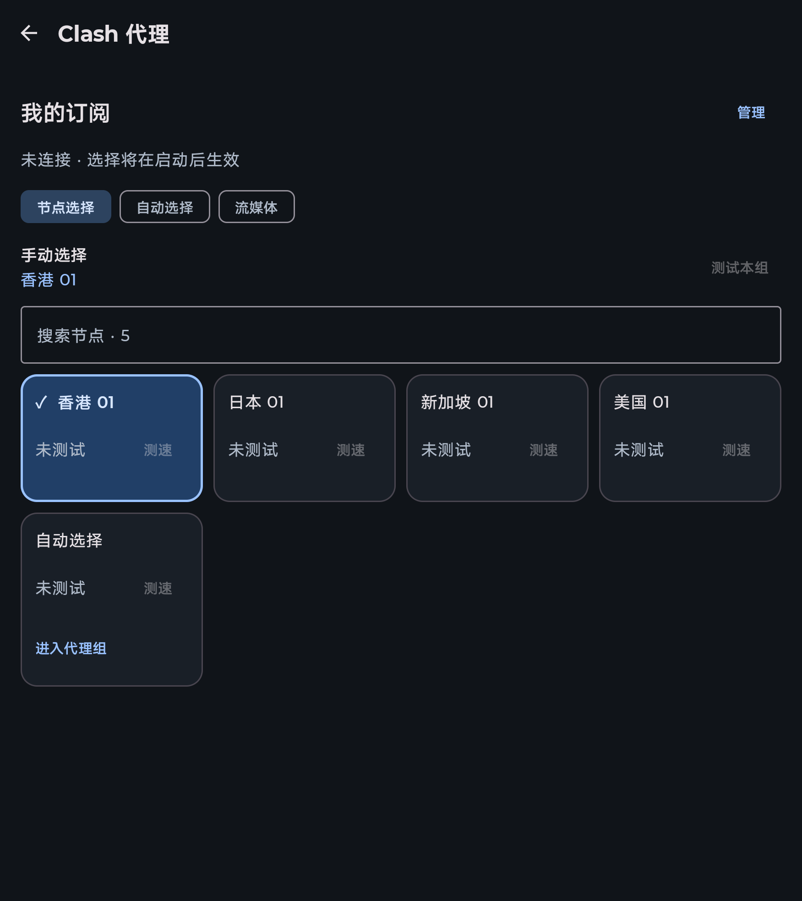

# OneTunnel

把 Clash、WireGuard 和 Tailscale 放进一个安卓 App。导入订阅、连接自己的设备，再按你的规则安排流量。

[官网](https://0use.net/OneTunnel/) · [开发文档](docs/DEVELOPMENT.md)

支持 Android 8 及以上的 ARM64 设备，目前处于 Alpha 测试阶段。

## 能做什么

- **Clash 订阅**：粘贴订阅链接或导入配置文件，查看代理组、选择节点、测试延迟。
- **WireGuard**：导入配置文件，或用相机、二维码图片添加连接。
- **Tailscale**：通过浏览器登录，连接自己的设备，查看在线设备列表。
- **自由分流**：按域名或网段选择连接方式，运行时也能编辑规则、长按拖动排序。
- **端口转发**：通过 WireGuard 或 Tailscale 访问本机的 SSH、网页等 TCP 服务，每条转发都有独立开关。
- **局域网代理**：自定义 HTTP 代理端口，按需分享给局域网设备，可设置账号认证。
- **日常使用**：浅色、深色与跟随系统，支持桌面小组件和下拉快捷开关，连接配置在本机加密保存。

## 界面

| 连接 | 代理组 |
| :---: | :---: |
|  |  |

更多界面可在[官网](https://0use.net/OneTunnel/)查看。

## 开始使用

1. 安装 ARM64 APK，打开 OneTunnel，点击“添加连接”。
2. 导入 Clash 订阅或 WireGuard 配置，或者添加 Tailscale 并完成浏览器认证。
3. 在“规则”页选择“其他流量使用”的出口，按需要添加分流规则。
4. 开启需要的连接，再打开首页总开关，完成系统 VPN 授权。

规则从上往下匹配，没有命中的流量使用“其他流量使用”指定的出口。可以选择国内直连，也可以自己调整；导入订阅时会保留它自带的规则。

Clash 一次启用一份订阅，WireGuard 和 Tailscale 可以同时启用多个。点击连接项可查看或编辑，修改后自动保存；运行中添加连接或调整规则时，已有网络连接可能短暂重连。

关闭应用界面后，已启动的 VPN 会继续运行；可以从应用、桌面组件或快捷开关断开。异常退出后需要手动重新连接。Android 同时只能运行一个 VPN，启动 OneTunnel 会替换当前 VPN。

## 开源

OneTunnel 基于 [Mihomo](https://github.com/MetaCubeX/mihomo)，项目采用 [GPL-3.0](LICENSE) 许可证。构建方法、上游版本与实现细节见[开发文档](docs/DEVELOPMENT.md)。
