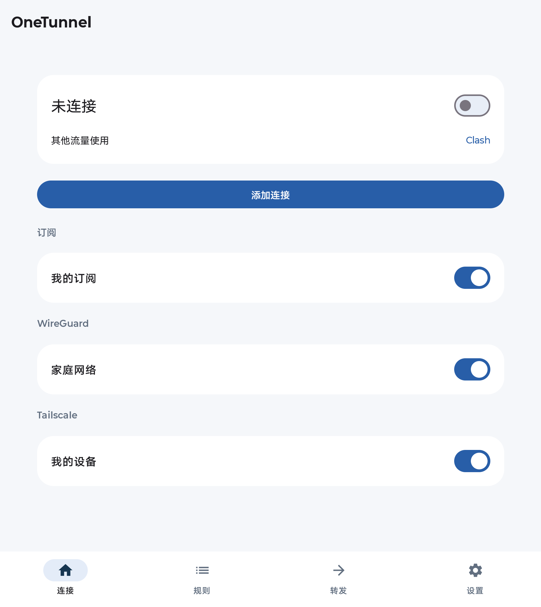

# OneTunnel

一个安卓 App，统一连接 Clash、WireGuard 和 Tailscale。

[官网](https://0use.net/OneTunnel/) · [开发文档](docs/DEVELOPMENT.md)

Android 8+ · ARM64 · Alpha

## 功能

- Clash 订阅、代理组与节点测速
- WireGuard 配置与扫码导入
- Tailscale 浏览器登录与设备互联
- 自定义分流、长按拖拽排序
- TCP 端口转发、局域网代理
- 明暗主题、桌面组件与快捷开关

## 界面

| 连接 | 代理组 |
| :---: | :---: |
|  |  |

## 使用

添加连接，设置分流，开启总开关。修改自动保存。

基于 [Mihomo](https://github.com/MetaCubeX/mihomo) · [GPL-3.0](LICENSE)
